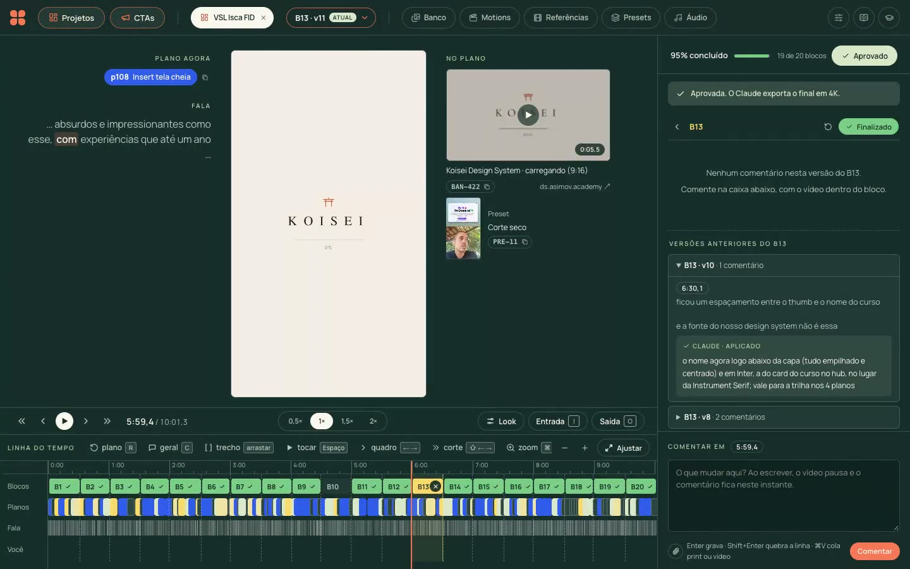

# agent-video-editor

Um editor de vídeo por linguagem natural: o **Claude Code é o editor**. Você manda o vídeo bruto (e, se quiser, um
briefing) e ele entrega a edição completa — cortes, 9:16, look, direção visual, inserts reais, motions, transições,
áudio e legenda. Você revisa num app local estilo frame.io, comenta no ponto exato do vídeo e avisa no chat: ele aplica e
renderiza a próxima versão. Aprovado, ele exporta em 4K e publica (Drive, Notion, Obsidian, agendamento).

[](docs/demo.mp4)

▶ **[Assista ao demo (1 min)](docs/demo.mp4):** um passeio pelo app (projetos, CTAs, a revisão por blocos, motions,
referências e calibragem) e, no fim, um trecho de um Reels editado por ele.

## Como funciona

Tudo mora em duas skills do Claude Code:

- [`editor`](.claude/skills/editor/SKILL.md) — do bruto ao vídeo aprovado:
  1. **Vídeo novo → v1, sem parar:** preparar (transcrição palavra a palavra, proxy, rosto, voz limpa) → cortes →
     direção (o roteiro dirigido, plano a plano) → inserts, motions, áudio, legenda e transições em paralelo (os inserts
     e os motions novos em subagentes) → enriquecimento → render e autorrevisão.
  2. **Revisão:** você comenta no app e avisa no chat ("comentei no VSL Isca"); o Claude aplica os comentários
     pendentes, renderiza a versão nova e responde cada um numa frase curta.
  3. **Aprovado:** exporta o final em 4K e conclui o vídeo — analisa por que errou em cada correção e grava os
     aprendizados que você confirmar, lidos antes de cada etapa nos próximos vídeos.
- [`publicar`](.claude/skills/publicar/SKILL.md) — do aprovado ao ar, a partir do que está exportado na pasta `final/`
  do projeto: sobe no Google Drive, cria os cards no Notion, atualiza a nota da copy no Obsidian e agenda (Metricool,
  ManyChat).

As decisões editoriais são do Claude, guiadas pelos exemplos do criador; os scripts validam, calculam tempos e
renderizam. Tudo fica preso às palavras da transcrição (IDs), nunca a segundos — o contrato está em
[`edicao.md`](.claude/skills/editor/edicao.md).

### A revisão por blocos

A revisão é por **blocos de ~30 s** (nenhum abaixo de 15 s; um vídeo curto é um bloco só), cortados nas trocas de plano
e presos às palavras (o mesmo bloco continua o mesmo trecho nas versões seguintes):

- escolha um bloco na linha do tempo: o painel mostra só os comentários dele e o que já foi pedido nele nas versões
  anteriores, com a resposta do Claude;
- **Finalizar** trava o bloco (o Claude não mexe mais nele); em cima, a % do vídeo concluída; **Aprovar** fecha o vídeo;
- cada bloco tem a sua **versão** (só sobe quando ele muda); uma estrela pulsando marca o bloco que mudou e você ainda
  não viu, e um loader marca os blocos em que o Claude está trabalhando;
- dá para comentar uma versão enquanto o Claude refaz outro bloco: os pendentes de todas as versões entram na próxima.

### As saídas: um vídeo, vários finais

Um projeto é um **corpo** (o que é comum a todas as versões) e várias **saídas**, cada uma com o seu final e com o nome
do destino (ManyChat, LP, VSL, Isca, BF Captura…): um final falado na mesma gravação, um CTA gravado à parte (um
projeto da página CTAs, inclusive os coringas, usados em vários vídeos) ou nenhum (o corpo puro). O Claude detecta os
finais falados no bruto; os de CTA entram pelo **+ Saída** do app ou pelo chat.

- no painel da direita, escolha a saída: o vídeo mostra os blocos do corpo seguidos do bloco **Final** dela; um
  comentário no Final vale só para aquela saída (e, num CTA, vai para o projeto do CTA);
- **Aprovar saída** exporta só ela; o **Aprovar** do projeto, todas. Cada uma sai em `final/saidas/<nome> - <destino>.mp4`;
- na saída com CTA à parte, o áudio é misturado de uma vez: a voz do CTA casada com a do corpo (timbre e volume) e uma
  trilha só do começo ao fim, para não dar para perceber a emenda.

## O app

`uv run ferramentas/servidor.py` → http://localhost:8719/app/

| Página | O que tem |
|---|---|
| **Projetos** e **CTAs** | os vídeos em edição e os aprovados (os CTAs, categorias com "CTA" no nome, à parte): tocar, aprovar e desaprovar no card, tags, ocultar, categoria e o código para citar no chat |
| **Revisão** (um projeto aberto) | o vídeo, a linha do tempo (blocos, planos, fala e comentários), o que entrou em cada plano, o provador de look e o painel de comentários (com prints e vídeos colados) |
| **Banco** | as mídias dos inserts, com selos (usada, aprovada, recusada), tags, trechos e o Recortar (o quadro e o começo e o fim) |
| **Motions** | as animações (HTML + GSAP) com a prévia em vídeo; ao vivo no modal |
| **Referências** | cada plano dos vídeos da Calibragem, por tipo, com favoritos e tags: o acervo de onde saem os presets |
| **Presets** e **Transições** | as receitas de enriquecimento e de corte, cada uma com a referência e a recriação lado a lado |
| **Áudio** | trilhas e sons |
| **Calibragem**, **Heurística** e **Aprendizados** | os vídeos de referência analisados (que ensinam a direção), as regras do criador por categoria e as correções que viraram regra |
| **Lixeira** | tudo o que se apaga no app (projetos, mídias do banco, referências), inteiro, em `biblioteca/lixeira/`: restaurar volta para onde estava; apagar de vez (um item, um tipo ou tudo) libera o espaço |

Cada vídeo tem uma **categoria** (📱 Reels, 📺 VSL, 💰 CTA… no painel Categorias), e cada categoria tem a sua
Calibragem, a sua Heurística e os seus aprendizados: a direção de um vídeo aprende com os vídeos da categoria dele.

## Estrutura

| Pasta | O que tem |
|---|---|
| `.claude/skills/` | `editor/` (`SKILL.md`, `etapas/` com um .md por etapa e `edicao.md`) e `publicar/` |
| `ferramentas/` | um script por etapa (`uv run ferramentas/<script>.py`, dependências no próprio arquivo, PEP 723); `servidor.py` (o app e a API); `inicial/`, a biblioteca de uma instalação nova |
| `render/` | a página que desenha inserts, motions e legenda para o render, com o runtime dos motions, fontes e fundos |
| `app/` | o app de revisão (HTML + JS puro, sem build) |
| `docs/` | o demo e o print do README |
| `biblioteca/` | o que é do criador (fora do git): exemplos da direção por categoria, aprendizados, presets, transições, sons, trilhas, LUTs, motions (e as prévias), banco de mídias, referências e a lixeira |
| `projetos/` | um vídeo por pasta (fora do git): o bruto, as versões, as revisões e o final |

Alguns comandos do dia a dia:

```bash
uv run ferramentas/revisao.py pendentes          # os projetos com comentários sem resposta (em qualquer versão)
uv run ferramentas/revisao.py ler <slug>         # os comentários pendentes, com bloco, palavra e plano
uv run ferramentas/revisao.py historico <slug>   # todas as revisões, para a conclusão
uv run ferramentas/render.py <slug>              # a versão nova (o render é incremental: só refaz o que mudou)
uv run ferramentas/render.py <slug> --final      # o final em 4K
uv run ferramentas/render.py <slug> --saidas     # exporta todas as saídas (ou --saida <id>, só uma)
uv run ferramentas/cortes.py saidas <slug>       # as saídas do projeto (saida / tirar-saida para mexer)
uv run ferramentas/render.py previas-motions     # as prévias da página Motions (só as que mudaram)
uv run ferramentas/servidor.py --limpar-caches 3 # o cache do render dos aprovados parados há 3 dias (o servidor faz sozinho, de hora em hora)
uv run ferramentas/codigo.py PRJ-12              # o que um código citado no chat é
```

### A biblioteca e os projetos

`biblioteca/` e `projetos/` ficam fora do git: um `git pull` nunca mexe nelas. Para levar a biblioteca para outra
máquina, **copie a pasta inteira por cima da de lá** (com o servidor parado): a de lá é substituída, e o que só existia
nela se perde. Sem biblioteca, o servidor cria uma inicial (`ferramentas/inicial/`: os aprendizados técnicos e dois
motions de exemplo). Os projetos são de cada um e não vão junto.

## Rodar

Precisa de [uv](https://docs.astral.sh/uv/), ffmpeg e o [Claude Code](https://claude.com/claude-code). As chaves ficam
num `.env` na raiz (nunca vão para o git):

```bash
OPENROUTER_API_KEY=...
ELEVENLABS_API_KEY=...
```

```bash
uv run ferramentas/servidor.py   # o app: http://localhost:8719/app/
```

E no Claude Code, dentro da pasta: *"edite este vídeo: /caminho/do/bruto.mp4"*. Depois, comente no app e avise no chat.
